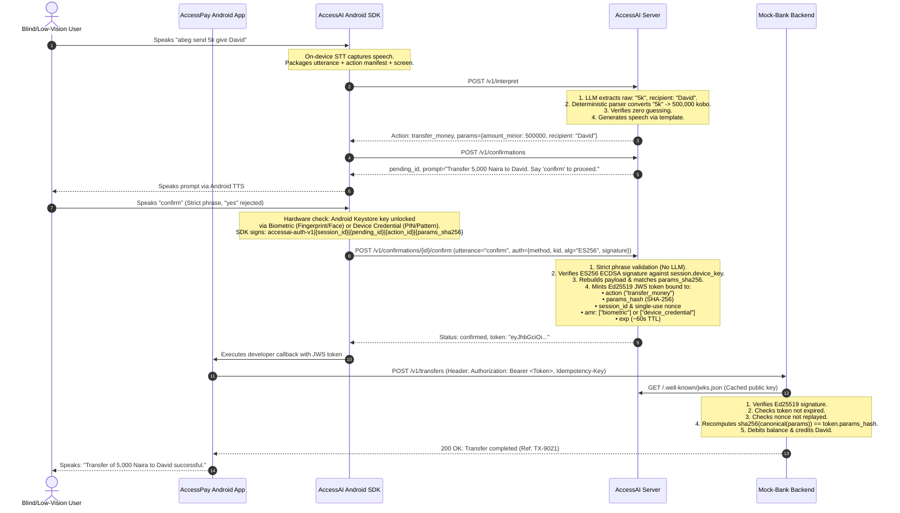

# AccessAI: End-to-End Integration Guide & Roadmap

## 1. System Architecture Overview

AccessAI is partitioned into three decoupled repositories to guarantee security, modularity, and clean developer adoption:

1. **`accessai-server`** (The AI Service):
   - Stateless interpretation and intent-routing service.
   - Converts raw speech/text into structured intents via an LLM tool-calling provider (Groq or Claude).
   - Deterministically parses Nigerian currency amounts into integer kobo.
   - Evaluates confirmation utterances strictly without an LLM.
   - Mints short-lived signed JWS tokens (Ed25519) and serves public keys via JWKS.
   - **Never moves money or executes transactions.**

2. **`accessai-android-sdk`** (The Developer SDK):
   - Embedded Kotlin library (`accessai-core` + `accessai-compose`).
   - Houses the `DialogMachine`, on-device STT (`SpeechRecognizer`), TTS (`TextToSpeech`), and local fallback rules.
   - Exposes developer-friendly Compose panels and TalkBack-accessible UI.
   - Interacts with `accessai-server` over REST to parse utterances and obtain cryptographically signed tokens.
   - **Never invokes an execution handler without a verified token.**

3. **`accesspay-demo`** (Customer Demo App & Mock Bank):
   - **`app/`**: Android Jetpack Compose banking application with TalkBack optimizations, balance displays, and transfer screens.
   - **`mock-bank/`**: Fast and isolated banking backend (FastAPI + SQLite). Owns the actual money logic, balance updates, and transaction logs.
   - **Validates the AccessAI JWS signature and parameter hash against `accessai-server`'s JWKS before debiting accounts.**

---

## 2. End-to-End Request Flow (The Safety Spine)



---

## 3. API Contract Specifications

### 3.1. Intent Interpretation
- **Endpoint**: `POST /v1/interpret`
- **Request**:
```json
{
  "session_id": "sess_8f3d10c2",
  "text": "abeg send 5k give David",
  "actions": [
    {
      "id": "transfer_money",
      "name": "send money",
      "description": "Transfer funds to another user",
      "sensitivity": "sensitive",
      "requires_confirmation": true,
      "params": [
        { "name": "recipient", "type": "string", "description": "Name of recipient", "required": true },
        { "name": "amount_minor", "type": "amount_minor", "description": "Amount in kobo", "required": true }
      ]
    },
    {
      "id": "get_balance",
      "name": "check balance",
      "description": "Inquire account balance",
      "sensitivity": "read",
      "requires_confirmation": false,
      "params": []
    }
  ],
  "screen_descriptor": "Home Dashboard",
  "dialog": {}
}
```
- **Response (Action)**:
```json
{
  "outcome": "action",
  "action_id": "transfer_money",
  "params": {
    "recipient": "David",
    "amount_minor": 500000
  },
  "missing_params": [],
  "confidence": 0.95,
  "spoken_prompt": "Transfer 5,000 Naira to David. Say 'confirm' to proceed, or 'cancel' to abort."
}
```

---

### 3.2. Pending Confirmation
- **Endpoint**: `POST /v1/confirmations`
- **Request**:
```json
{
  "session_id": "sess_8f3d10c2",
  "action_id": "transfer_money",
  "params": {
    "recipient": "David",
    "amount_minor": 500000
  }
}
```
- **Response**:
```json
{
  "pending_id": "conf_3b1a89c0",
  "session_id": "sess_8f3d10c2",
  "action_id": "transfer_money",
  "params": {
    "recipient": "David",
    "amount_minor": 500000
  },
  "params_sha256": "4a7d...canonical_sha256",
  "status": "pending",
  "spoken_prompt": "Transfer 5,000 Naira to David. Say 'confirm' to proceed, or 'cancel' to abort.",
  "expires_at": 1793649660
}
```

---

### 3.3. Strict Confirmation & JWS Minting
- **Endpoint**: `POST /v1/confirmations/{id}/confirm`
- **Request**:
```json
{
  "utterance": "confirm"
}
```
- **Response**:
```json
{
  "status": "confirmed",
  "confirmation_id": "conf_3b1a89c0",
  "token": "eyJhbGciOiJFZERTQSI...",
  "expires_at": 1793649660,
  "spoken_prompt": "Transfer of 5,000 Naira to David confirmed."
}
```

---

### 3.4. Verification Key Distribution (JWKS)
- **Endpoint**: `GET /.well-known/jwks.json`
- **Response**:
```json
{
  "keys": [
    {
      "kty": "OKP",
      "crv": "Ed25519",
      "kid": "voice-intent-key-1",
      "use": "sig",
      "alg": "EdDSA",
      "x": "6C4O6m_pE9gqQ7kZ..."
    }
  ]
}
```

---

## 4. Next Steps for the Team (14-Day Timeline)

### Phase 1: Day 1–2 (Completed / Contract Freeze)
- [x] Build and test `accessai-server` (FastAPI, Groq / Claude providers, deterministic amount parser).
- [x] Run 150-utterance eval benchmark with 100% accuracy and 0 guessed transfers.
- [x] Export `contracts/v1/` schemas (`openapi.json` + Pydantic JSON schemas) for SDK consumption.
- [x] Push `accessai-server` to GitHub repository.

### Phase 2: Day 3–6 (Android SDK Core & Mock Bank)
1. **Android SDK (`accessai-android-sdk`)**:
   - Initialize Kotlin library (`minSdk 24`, Coroutines/Flow, `kotlinx.serialization`).
   - Copy `contracts/v1/*.json` into `src/test/resources` and create contract tests.
   - Implement `DialogMachine` state transitions:
     - `Idle` $\rightarrow$ `Listening` $\rightarrow$ `Interpreting` $\rightarrow$ `AwaitingConfirmation` $\rightarrow$ `Executing`.
   - Implement `ConfirmationGate`: enforce that host action callbacks are impossible to invoke without a verified JWS token.
   - Implement audio fallback: Fallback to text input when mic permission is denied; announce connectivity warnings when offline.
2. **Mock Bank Backend (`accesspay-demo/mock-bank`)**:
   - Scaffold FastAPI + SQLite service.
   - Seed account: Balance ₦84,250; beneficiaries David Adeyemi, David Okafor, Amaka Obi.
   - Implement `POST /v1/transfers`: Fetches `GET /.well-known/jwks.json`, verifies Ed25519 signature, checks nonce replay cache, verifies `params_hash`, and executes debit.

### Phase 3: Day 7–9 (UI Panel & Demo Integration)
- Build `accessai-compose` UI: Accessible slide-up drawer with high-contrast text, TalkBack semantic grouping, and active mic pulse.
- Wire `accesspay-demo/settings.gradle.kts` with `includeBuild("../accessai-android-sdk")`.
- Integrate the 4 core actions (`get_balance`, `transfer_money`, `navigate_to_transfer`, `get_transaction_history`).

### Phase 4: Day 10–14 (Testing, Polish & Demo)
- Run accessibility audit: Google Accessibility Scanner + live TalkBack navigation pass.
- Test edge cases: Ambiguous "David", cancelled confirmation, replayed token, double "confirm", insufficient funds.
- Publish `v0.1.0` SDK tag to JitPack.
- Record final demo video showing voice-assisted balance checks and money transfers with blindfolds / TalkBack enabled.
